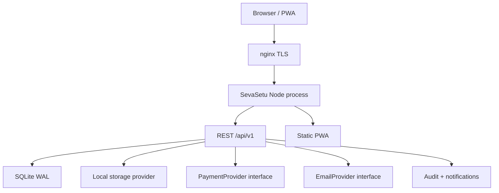

# SevaSetu Architecture

## Application architecture

## Role matrix

| Module | Super admin | NGO admin | Staff | Teacher | Volunteer | Donor | Parent | Student | Public |
|--------|-------------|-----------|-------|---------|-----------|-------|--------|---------|--------|
| Approve NGOs | yes | no | no | no | no | no | no | no | no |
| Own NGO data | yes | yes | assigned | classes | events | own | own children | own | no |
| Donate | yes | yes | no | no | no | yes | no | no | yes |
| Inventory | yes | yes | yes | no | assist | no | no | no | no |
| Attendance | yes | yes | yes | yes | field | no | view | view | no |

## Sitemap

Public: Home, NGOs, NGO profile, Programs, Campaigns, Donate, Volunteer, Events, Impact, Stories, About, Contact, Transparency, Map, FAQ, Privacy, Terms, Refund, Login.

Admin: Overview, NGOs, Users, Audit, Settings, Backup, CMS, Stories, all operations modules, Reports, Import, Search, Profile.

NGO: Overview plus education, inventory, distribution, finance, volunteers, documents.

User: Overview, donations, sponsorships, learning, requests, messages, profile.
